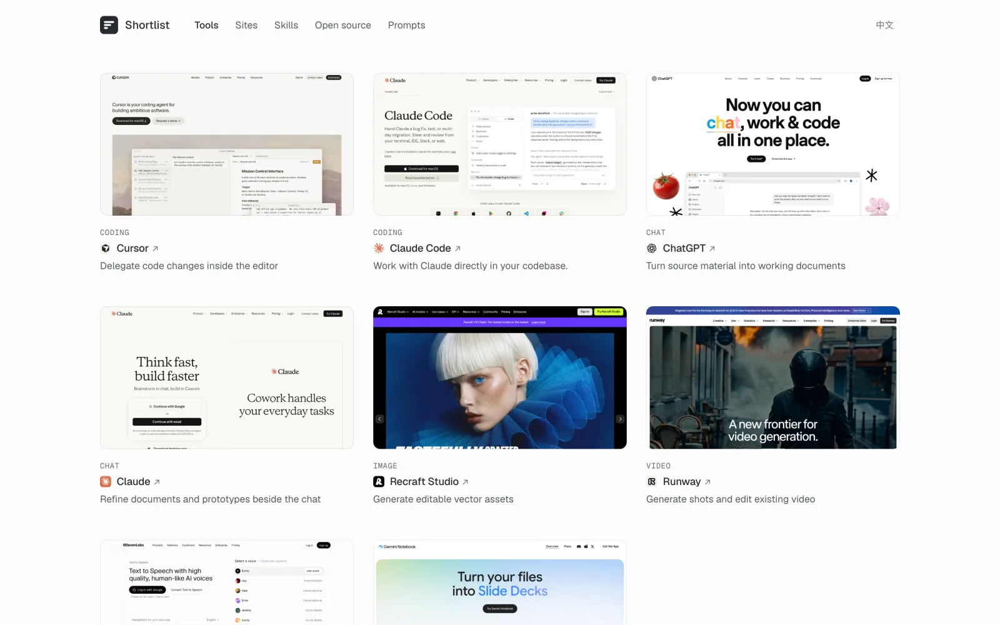

# Wenworks AI · 工具精选

一份有立场的精选清单，给做东西的人：只收真正值得用的工具、素材与站点、技能、开源项目和提示词，每条都用一句话说清它为什么在这里。中文为主，另有英文版。它是 Wenworks AI 的三个站之一，另外两个是[模型](https://models.wenworks.app/)和 [Agent 导航](https://agents.wenworks.app/)，三个站共用一套视觉规范（[design/wenworks-ai-design.md](design/wenworks-ai-design.md)）。原名 Vectortrove。

**线上地址：<https://tools.wenworks.app/>**



## 它由两部分组成

| | 公开站 | Curator |
|---|---|---|
| 给谁用 | 读者 | 维护者（在本机） |
| 做什么 | 按板块浏览资源，每条一张官网封面、分类、名称和一句判断 | 收录链接、让 Agent 起草、编辑、补封面、发布到公开目录 |
| 在哪 | `app/(zh)/`（中文，根路径）与 `app/en/`（英文，`/en/`），共用 `components/SiteRoutes.tsx`；静态导出，部署在 Cloudflare | `app/curator/` + 本地服务 `scripts/curator-server.mjs`，不随站点部署 |

数据只朝一个方向流动：

```
Curator 编辑 → .curator/content.sqlite → 导出 data/ 与 content/ → git push → Cloudflare 构建发布
```

SQLite 是唯一的编辑源，只在本机；公开站只读导出的 JSON 和 Markdown，从不访问数据库。

> **换电脑或新克隆时注意**：`.curator/content.sqlite` 不在仓库里。没有它时 Curator 会从 `data/tools.json` 重建一个**只有工具**的库，站点、技能、项目、提示词不会恢复；这时一旦保存或导出，`content/` 下的这些文件会被清空。先把原来的 `.curator/` 目录拷过来再启动。

## 本地运行

需要 Node 24。

```bash
npm install
npm run dev          # 只看公开站：http://localhost:3000（中文），/en/ 是英文
npm run curator      # 公开站 + Curator：http://localhost:3000/curator/
```

`npm run curator` 同时启动 Next 开发服务器和 Curator 本地服务（只监听 `127.0.0.1:4317`）。第一次用要在 **设置** 里填 AI 连接的网关地址、API Key 和模型，配置存在 `.curator/pi-config.json`，不会提交。

抓封面图还需要本机装有 Chrome 和 `cwebp`（`brew install webp`）。

## 日常维护

1. **收录**：在工作台顶部粘贴链接，可以一次多条。Agent 读取官网、生成双语草稿，同时抓 logo 和封面。已在资源库的链接会自动跳过。
2. **核对**：在资源的工作区里改字段，或者直接让右侧助手改。类型选错了可以转换。
3. **发布到公开目录**：保存时选择加入公开目录，服务会立即重新导出 `data/` 和 `content/`。
4. **上线**：工作台右侧会显示有多少公开文件还没提交。提交并推送到 `main`，GitHub Actions 自动构建发布。

工作台的「待处理」列出每条资源缺什么（缺封面、缺分类、缺英文正文、卡片文案会被截断……），点进去补齐即可。

## 内容放在哪

| 位置 | 内容 |
|---|---|
| `data/tools.json` | 工具板块 |
| `content/{sites,skills,projects,prompts}/*.md` | 其他四个板块，JSON frontmatter + 中文正文 |
| `data/taxonomy.json` | 分类和标签词表 |
| `data/route-aliases.json` | 资源换板块或改 slug 后的旧地址跳转 |
| `public/logos/` `public/covers/` | 本地化的 logo 和封面图 |
| `lib/i18n.ts` | 界面文案（导航、按钮），和内容数据分开 |
| `.curator/` | SQLite、Agent 配置、运行记录（不提交） |

每条资源的核心是一句双语判断：工具是 `tagline`（公开站上的 verdict），其他板块是 `summary`。工具缺双语 verdict 会让构建直接失败。完整字段见 [docs/data-model.md](docs/data-model.md)。

## 封面图

普通网站用无头 Chrome 截官网首屏（1440 宽，保留顶部 16:9，底部的 Cookie 条会被裁掉）；GitHub 仓库用它的分享卡片。收录时自动采集，编辑页也能重新采集。

有些访问地址是登录页或会拦截自动访问，这时要改从官网介绍页截图：

```bash
npm run curator:covers                       # 列出缺封面的已发布条目
npm run curator:covers -- --write            # 采集
npm run curator:covers -- --write --force --source claude=https://claude.com/ --source chatgpt=https://openai.com/chatgpt/overview/ --source gemini-notebook=https://notebooklm.google/ --source hugeicons=https://hugeicons.com/icons
```

`--source id=URL` 换一个页面截图，`--og id` 直接用页面的分享图。这两个参数不会存下来，全部重抓时要带上。

## 命令

| 命令 | 用途 |
|---|---|
| `npm run dev` | 公开站开发服务器 |
| `npm run curator` | 公开站 + Curator |
| `npm run build` | 静态导出到 `out/` |
| `npm run lint` / `npm test` | ESLint / Curator 脚本的单元测试 |
| `npm run curator:export:check` / `curator:export` | 查看 / 写入从 SQLite 到 `data/`、`content/` 的导出 |
| `npm run curator:covers` | 批量采集封面图 |
| `npm run curator:migrate:check` / `curator:migrate` | 在副本上检查 / 备份后执行数据库迁移 |
| `npm run curator:db:import` | 没有本地数据库时，从 `data/tools.json` 重建（只含工具，见下方提醒） |

## 技术栈

- Next.js 16（App Router，构建时 `output: "export"`）、React 19、TypeScript
- 公开站：手写 CSS，无 UI 库；Geist 字体；明暗双主题；页面转场用 React `<ViewTransition>` 和 transitions.dev 的动效 token
- Curator：Mantine 9，Node 内置 `http` 与 `node:sqlite`；AI 调用基于 [Vercel AI SDK](https://ai-sdk.dev)（`ai` + `@ai-sdk/anthropic`，走兼容 Anthropic Messages 的网关），工具、编辑规则（[skills/curator-ingest/SKILL.md](skills/curator-ingest/SKILL.md)）和任务队列都在本仓库

## 部署

站点托管在 Cloudflare Workers 的静态资源上（[`wrangler.jsonc`](wrangler.jsonc)），域名 `tools.wenworks.app`。Worker 的名字仍是 `vectortrove`（Workers Builds 绑定的是这个名字，不要改）。旧域名 `vectortrove.com` 和 `shortlist.vectortrove.com` 已经停用，没有跳转。Cloudflare 连着这个 GitHub 仓库，推送到 `main` 就自动构建（`npm run lint && npm run build`）并执行 `npx wrangler deploy` 上传 `out/`。Curator 里的「上线」按钮做的就是提交内容并推送。

- `public/.assetsignore` 随构建复制进 `out/`，让 wrangler 不上传 `out/curator/`（本地管理界面）。
- 中文在根路径、英文在 `/en/`。`public/_redirects` 把旧的 `/zh/...` 链接 301 到去掉前缀的新地址。
- Node 版本由 `.node-version` 指定。

搜索与分享相关的文件都在构建时生成，不需要额外操作：

- `app/sitemap.ts` 输出 `sitemap.xml`，列出首页和全部详情页的中英两版，并互相标注语言版本；工具没有详情页，换过地址的旧链接也不收录。
- `app/robots.ts` 输出 `robots.txt`，指向站点地图并屏蔽 `/curator/`。
- 每个页面都带规范链接、中英互指（hreflang）和分享卡片（Open Graph / Twitter）。详情页用条目自己的封面，其他页面用 `public/og.png`。这些逻辑在 `lib/seo.ts`。

两个可选的构建变量，在 Cloudflare 的构建设置里配置：

| 变量 | 用途 |
|---|---|
| `NEXT_PUBLIC_SITE_URL` | 规范链接、站点地图和分享卡片用的完整域名，默认 `https://tools.wenworks.app` |

CI 里没有本地数据库，所以不跑导出，直接用已提交的 `data/` 和 `content/`——发布前记得先把导出的文件提交。线上只有公开站的静态文件，不含 Curator、数据库、Agent 记录或任何密钥。

首次部署：Cloudflare 控制台 → Workers & Pages → 创建 → 导入 Git 仓库，构建命令填 `npm run lint && npm run build`，部署命令保持 `npx wrangler deploy`。自定义域名由 `wrangler.jsonc` 的 `routes` 自动绑定。也可以在本机 `npx wrangler login` 后 `npm run deploy` 手动构建并发布。

## 更多文档

- [docs/architecture.md](docs/architecture.md)：系统架构和 Curator 服务 API
- [docs/curator.md](docs/curator.md)：Curator 运行手册
- [docs/data-model.md](docs/data-model.md)：内容模型和状态
- [docs/roadmap.md](docs/roadmap.md)：产品规划
- [design-qa.md](design-qa.md) / [curator-design-qa.md](curator-design-qa.md)：界面改动与验证记录
