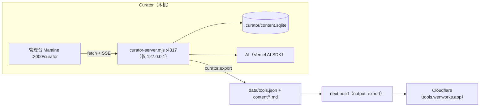

# 系统架构

本文描述当前实现。三个组成部分、一条数据流：**Curator 编辑 → SQLite → 导出 → 公开站静态消费**。

## 组成

| 部分 | 技术 | 职责 |
|------|------|------|
| 公开站（`app/(en)/`、`app/zh/`） | Next.js 16 `output: "export"`、React 19、定制 CSS | 只读静态产物，中英双版，部署在 Cloudflare Workers 静态资源 |
| Curator 前端（`app/curator/` + `components/`） | Mantine 9 | 本地管理台：工作台、资源库、编辑器、收录、系统 |
| Curator 服务（`scripts/curator-server.mjs`） | Node 内置 `http` + `node:sqlite` | 本地 API：内容 CRUD、AI 收录、候选版本、静态导出、构建校验 |

公开站与 Curator 前端互不依赖样式：公共站是无框架定制 CSS（`app/globals.css` + `app/transitions/`），Curator 走 Mantine（主题定制 `app/curator/curator.css`）。

## 数据流



- 编辑源只有 SQLite；`data/` 与 `content/` 是**派生文件**，每次保存/发布/删除后由服务自动重新导出，也可用 `npm run curator:export` 手动触发。
- 公开站构建时通过 `lib/data.ts`（读 `data/tools.json`）与 `lib/public-content.ts`（读 `content/**/*.md` 的 JSON frontmatter + Markdown）加载内容，不做任何数据库访问。
- 服务只监听 `127.0.0.1`，CORS 只放行本站来源（`CURATOR_ALLOWED_ORIGIN` 可追加）。

## 公开站路由

| 路由 | 说明 |
|------|------|
| `/`、`/zh/` | 首页（英文在根路径，中文在 `/zh/`；旧的 `/en/...` 由 `_redirects` 301 到新地址）：工具 / 技能 / 项目 / 站点 / 提示词五个板块（客户端切换，无单独路由） |
| `/skills/[slug]` `/projects/[slug]` `/sites/[slug]` `/prompts/[slug]`（中文加 `/zh` 前缀） | 分类详情页（`generateStaticParams` 由 `content/` 驱动，无内容时保留 `__empty__` 占位路由命中 `notFound()`——`output: export` 要求动态段至少产出一个路由） |
| `/curator/**` | 管理台（CI 发布前会从 `out/` 移除） |

内容文件是 JSON frontmatter + Markdown（`lib/public-content.ts` 解析），`status !== "active"` 的文件不参与构建。

## Curator 服务 API（`http://127.0.0.1:4317`）

| 方法与路径 | 用途 |
|------|------|
| `GET /health` | 服务状态、AI 连接可用性、构建任务 |
| `GET /agents` | AI 连接是否可用与网关模型列表 |
| `GET /pi-config` `PUT /pi-config` `DELETE /pi-config` | 读取（不含明文 Key）/ 保存 / 清除 AI 连接 |
| `POST /pi-config/test` `POST /pi-config/models` | 用最小请求测试连接 / 从网关拉取模型列表 |
| `GET /build` `POST /build` | 查询 / 启动构建检查（`next build`，日志轮询） |
| `GET /content` | 内容分页列表（板块/状态/检索/排序/`issues=true` 问题过滤），附全量 `counts` 和每条的问题代码 |
| `PUT /content/batch` | 批量公开或归档 |
| `POST /dashboard/fix` | 让 AI 批量完善所选条目（补封面、补分类、翻译等），跳过忙碌或有待处理提案的条目 |
| `GET /ship` | 待上线的内容改动：条目标题、图片数、列表文件数、上次上线时间（只读） |
| `POST /ship` | 提交 `data/`、`content/`、`public/covers/`、`public/logos/` 并推送 `main`；不在 main、正在合并、落后远端或没有改动时拒绝 |
| `GET /workspaces` `POST /workspaces` | 工作区列表 / 新建或打开（`slug` 打开已有内容） |
| `GET /workspaces/:id` `GET /workspaces/:id/events` | 工作区详情 / SSE 事件流 |
| `POST /workspaces/:id/message` `…/stop` | 给 AI 助手发要求（`mode: "ingest"` 为收录）/ 停止或取消排队 |
| `POST /workspaces/:id/draft` `…/save` `…/proposal` `…/undo` `…/convert` | 编辑草稿 / 保存或发布 / 采用或放弃提案 / 撤销 / 类型转换 |
| `POST /workspaces/:id/cover` `…/logo` | 抓封面截图 / 抓图标 |
| `POST /workspaces/:id/dismiss` | 关闭工作区 |

AI 收录管线：服务器把 `skills/curator-ingest/SKILL.md`（编辑口径与边界）+ 目标 URL + 目录快照交给模型（`scripts/curator-ai.mjs`，Vercel AI SDK `streamText`）。模型通过受控的 `web_fetch` / `web_search` 工具取证，并用 `submit_draft` 提交符合 schema 的唯一草稿；服务器负责任务队列、SSE 进度、字段校验、同域查重、Logo 固化与导出。Agent 失败即失败（显示原因），没有备用草稿。

## 环境变量

| 变量 | 默认 | 说明 |
|------|------|------|
| `CURATOR_PORT` | `4317` | 服务端口 |
| `CURATOR_SITE_PORT` | `3000` | 公开站 dev 端口（决定 CORS 白名单与"打开公开站"链接） |
| `CURATOR_CONTENT_DB` | `.curator/content.sqlite` | 数据库路径 |
| `.curator/pi-config.json` | Curator「系统」页 | 当前项目专用的 AI 网关、密钥与默认模型（文件名沿用旧名）；忽略提交，文件权限为 `0600` |
| `CURATOR_ALLOWED_ORIGIN` | 本站来源 | 追加允许的 CORS 来源 |
| `NEXT_PUBLIC_CURATOR_API_URL` | `http://127.0.0.1:4317` | 前端访问的服务地址 |
| `PAGES_BASE_PATH` | 未设置 | 站点挂在子路径时的 `basePath`；根域名部署不设 |
| `NEXT_PUBLIC_BASE_PATH` | `""` | 由 `next.config.ts` 从上面派生，Logo 路径拼接用 |

## 部署

Cloudflare 连接本仓库，推送 `main` 后构建（lint → `next build`，不跑 `curator:export`，直接用已提交的 `data/`、`content/`）并 `wrangler deploy` 上传 `out/`；`out/.assetsignore` 排除 `out/curator/`。配置见 `wrangler.jsonc`。线上不含数据库、服务与任何 Agent 记录。

## 目录速览

```
app/(en)/ app/zh/    公开站路由：英文在根路径、中文在 /zh/，都是 components/SiteRoutes.tsx 上的薄文件
app/curator/         管理台路由（Mantine，含 curator.css）
components/          公开站组件 + components/curator/ 管理台组件
lib/                 数据加载、内容模型、i18n、服务客户端
scripts/             curator-server / -dev / -db / -migrate / -export
data/  content/      派生静态产物（公开站只消费这些）
.curator/            SQLite 编辑源与运行记录（gitignore）
```
