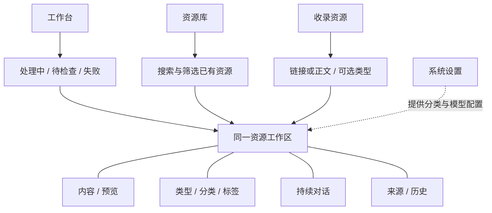
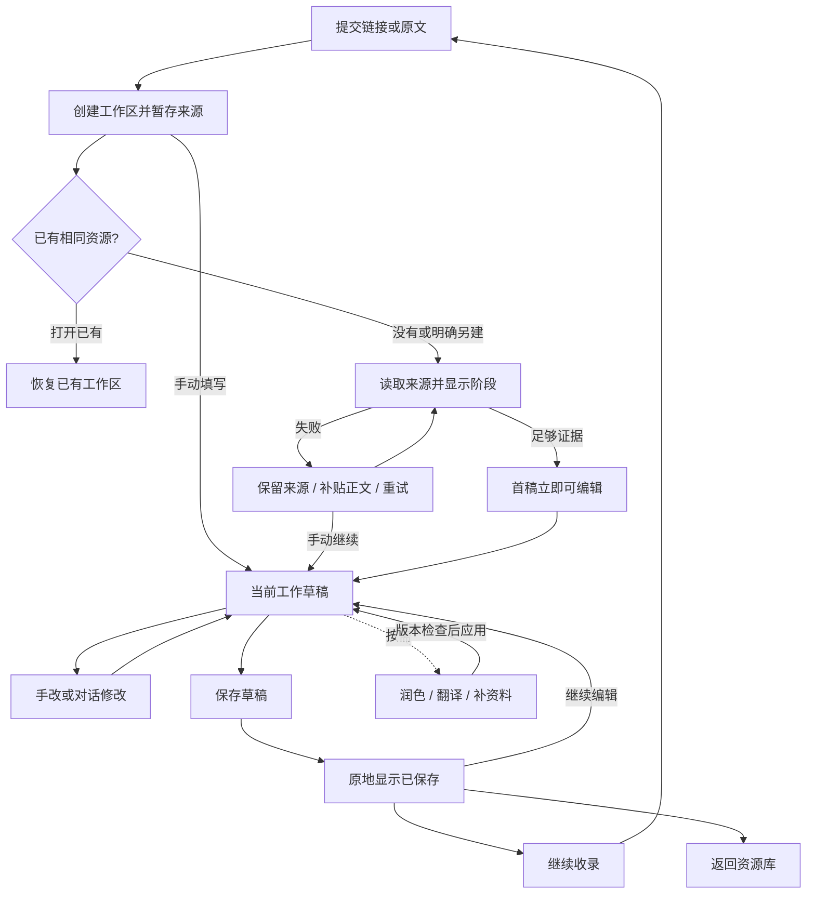
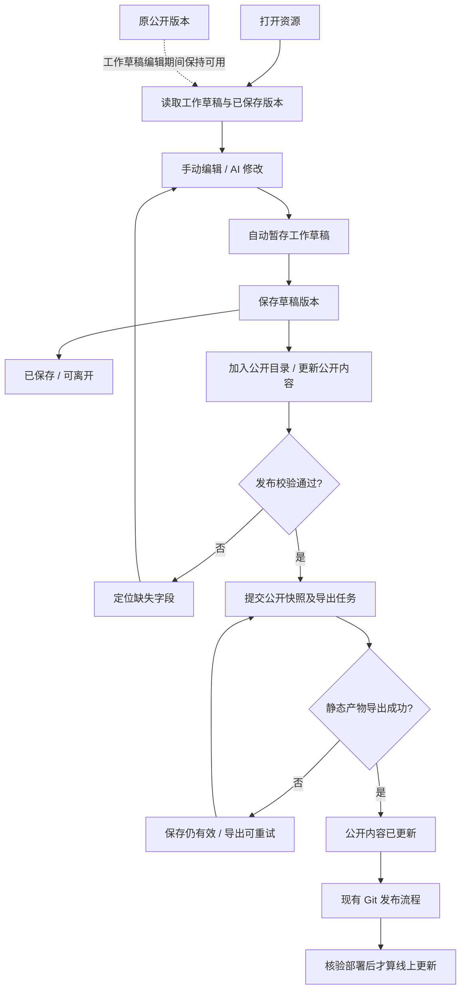
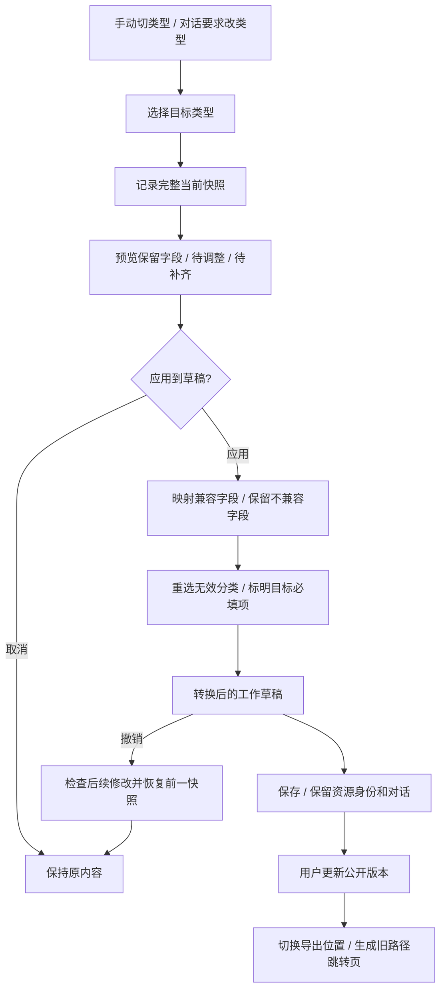
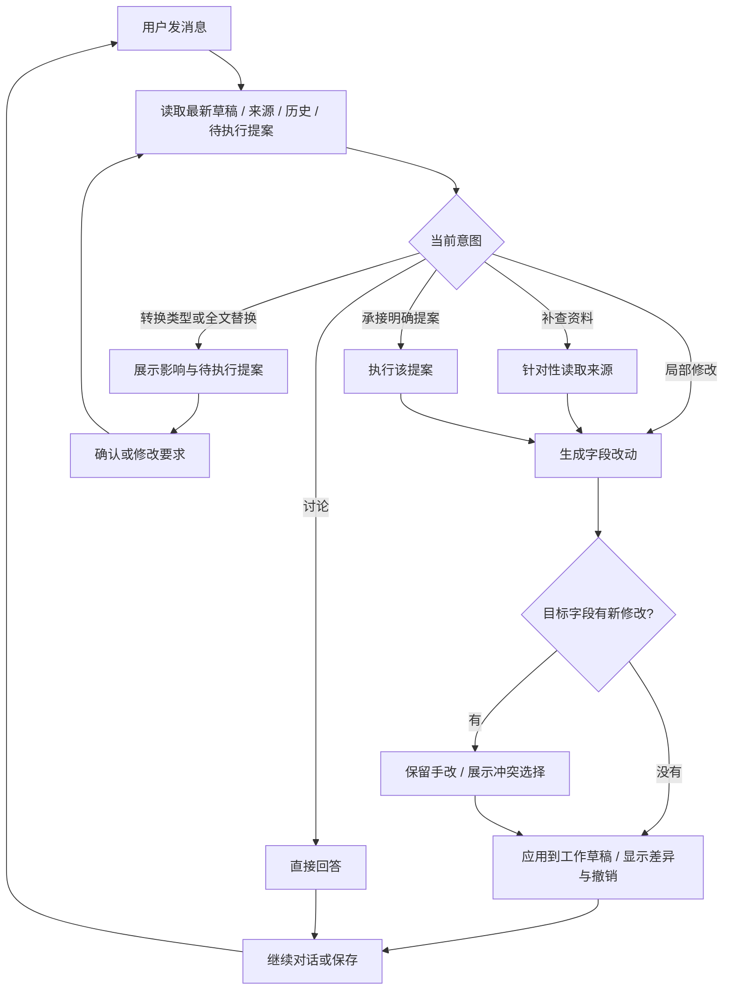
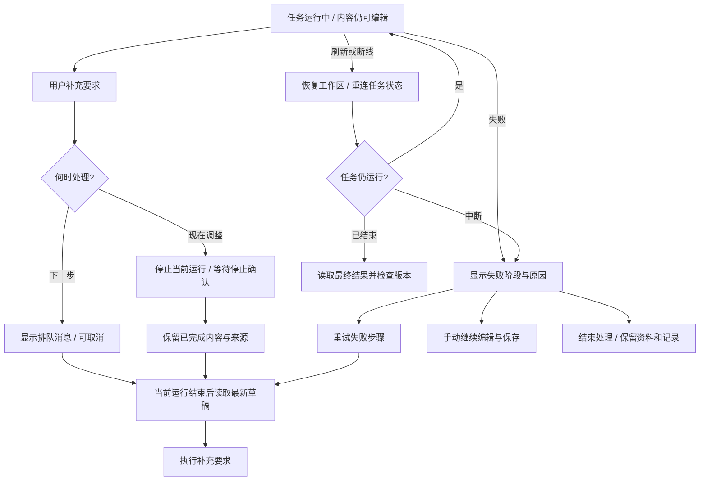
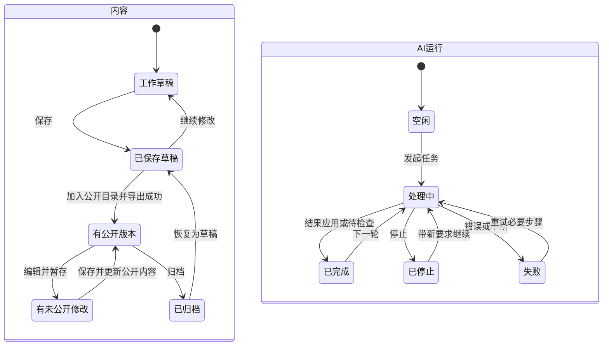

# Curator 流程草图 v1

日期：2026-09-08。目标流程，尚未实施。配套：[设计方案](curator-workflow-redesign.md) · [可点击页面草图](curator-workflow-sketch.html)。

## 01 入口与信息架构

工作台解决“接着处理”，资源库解决“找到内容”，收录入口解决“开始一条”。工作区负责把事情做完。

## 02 新收录至完成

首稿出来即可检查类型与内容。润色、翻译不阻塞首稿交付；保存后没有强制跳页。

## 03 已有资源修改与公开版本

保存、导出和线上部署各有结果。已发布条目的编辑草稿不会自动替换公开版本。

## 04 大分类改错后的恢复

示例：技能转站点时，长正文保留在历史中，不能因站点没有长文字段而丢失。保存草稿不立即移除旧公开页面。

## 05 Agent 多轮处理

“好的”承接当前唯一且有效的提案，不需要重复完整指令。聊天本身不隐含发布权限。

## 06 处理中补充要求与异常

结束处理把任务移出待处理队列，不把失败改写成成功，也不删除资料。恢复表示复用上下文重新执行必要步骤，不承诺从任意模型位置续跑。

## 07 内容状态与 AI 状态独立

## 08 低保真页面的评审路径

打开配套 HTML 草图，按顺序操作：

1. 收录：输入来源，点击“开始整理”，查看处理中与首稿状态。
2. 编辑：修改摘要，向 Agent 发送“摘要短一点”，查看同一草稿变化及撤销。
3. 类型转换：将技能切成站点，查看影响，再应用或取消。
4. 保存：点击“保存草稿”，停留原地；选择继续收录或返回资源库。
5. 异常恢复：查看读取失败，选择补贴正文、重试或手动继续。

草图只演示上述产品交互和页面结构，不是可操作真实数据的后台，也不代表真实模型性能。原始流程以本文件的 Mermaid 为可维护源。

## 本次草图检查记录

- JavaScript 语法检查及差异空白检查通过。
- 在实际浏览器检查了 1280px 桌面布局和 390px 窄屏布局；两种宽度均未产生横向溢出。
- 已操作：提交来源、处理中排队补充要求、首稿完成后执行摘要修改、类型转换预览及应用、转换后手动改标题、撤销转换且保留标题、保存原地完成、继续收录、窄屏内容与对话切换、错误恢复操作展示。
- 草图不持久化演示数据，刷新会复位；自动暂存、模型回答、发布和恢复结果均为设计演示，不是后台能力验收。
- Mermaid 源共 7 张；本轮未使用 Mermaid 渲染器逐张验证，阅读器需支持 Mermaid。
